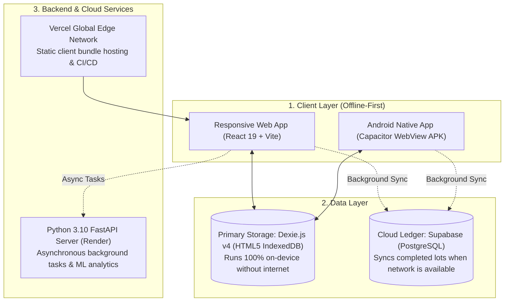
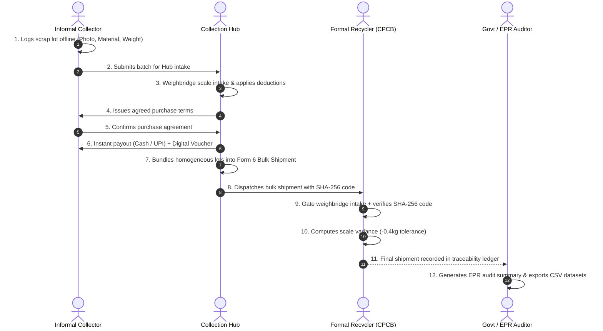

# KABADIWALA CONNECT — COMPLETE PROJECT REPORT
### Bringing the Informal Collector into the Formal Recycling Chain
**Developed by Team TECHCHALLENGERS1817**  
**Academic Project Expo & Technical Evaluation Report**

---

## 1. Executive Summary

Electronic waste (e-waste) is one of the fastest-growing solid waste streams globally. In India, approximately **90% to 95% of domestic e-waste collection and dismantling is handled by the informal sector**—independent street collectors (*Kabadiwalas*), aggregators, and scrap dealers. 

While informal collectors possess unparalleled hyper-local collection efficiency, they face severe challenges:
1. **Financial Exploitation**: Middlemen buy scrap without transparent market pricing or calibrated weighing.
2. **Hazardous Dismantling**: Lack of protective equipment leads to severe toxic exposure (lead, mercury, cadmium).
3. **Regulatory Disconnection**: Under India's **E-Waste (Management) Rules, 2022**, formal recyclers must fulfill **Extended Producer Responsibility (EPR)** quotas traceable via **Central Pollution Control Board (CPCB) Form 6 transfer manifests**. Informal scrap has historically been ineligible for formal EPR credits due to missing audit trails.

**Kabadiwala Connect** bridges this systemic gap. It is an **offline-first progressive web and native Android platform** that empowers informal collectors with transparent pricing, voice guidance, and digital receipts, while allowing intermediate collection hubs to bundle street scrap into CPCB-compliant, tamper-evident bulk shipments for formal recyclers.

---

## 2. Project Deliverables & Live Links

| Deliverable | URL / File Location | Status |
| :--- | :--- | :--- |
| **Live Production Web App** | [https://kabadiwala-connect-pearl.vercel.app](https://kabadiwala-connect-pearl.vercel.app) | 🟢 Hosted on Vercel |
| **Live Cloud Backend API** | [https://kabadiwala-connect-1-8our.onrender.com](https://kabadiwala-connect-1-8our.onrender.com) | 🟢 Hosted on Render |
| **Interactive API Documentation** | `https://kabadiwala-connect-1-8our.onrender.com/docs` | 🟢 Swagger UI |
| **Android APK (Native App)** | `E:\K\KabadiwalaConnect-latest.apk` (4.38 MB) | 📱 Compiled & Ready |
| **GitHub Source Code** | [https://github.com/jacksparrowlover17-dotcom/kabadiwala-connect](https://github.com/jacksparrowlover17-dotcom/kabadiwala-connect) | 🐙 Synced on `main` |

---

## 3. System Architecture & Tech Stack



### Detailed Technology Choices:
1. **Frontend**: **React 19**, **TypeScript**, **Vite 8.3**, **Tailwind CSS**.
2. **Mobile Packaging**: **Capacitor 8** targeting Android SDK 34 via Gradle.
3. **Primary Database**: **Dexie.js v4 (IndexedDB)**.
   - *Why*: Informal collectors operate in scrapyards and basements with poor cellular connectivity. All CRUD operations (logging lots, setting rates, generating manifests, recording disbursements) execute instantly offline.
4. **Cloud Database**: **Supabase (PostgreSQL)** for remote audit replication.
5. **Backend**: **FastAPI** + **Uvicorn** on Python 3.10, featuring asynchronous background task queues.
6. **Cryptography**: Deterministic **SHA-256** checksum truncated to a 6-digit tamper-evident cargo code.

---

## 4. End-to-End Stakeholder Lifecycle



---

## 5. Detailed Module & Feature Breakdown

### 5.1 Informal Collector Portal (`/`, `/new`, `/prices`, `/safety`, `/handover/:id`)
- **Multilingual TTS Voice Guidance**: Native browser SpeechSynthesis greetings and financial summaries in **Hindi, Marathi, Tamil, Telugu, Kannada, and English**.
- **Camera Capture with Compression**: Client-side canvas compression down to under 150KB base64 strings to ensure fast IndexedDB storage without quota exhaustion.
- **Dynamic Price Board**: Real-time market rate indicators (PCB ₹250/kg, Copper Cables ₹450/kg, Mobile Phones ₹1,200/kg) with rising/stable/falling trend indicators.
- **Safety Hazards Guide**: Voice-enabled hazard protocols for lithium battery fires, acid leaks, CRT phosphorus, and protective gear.
- **Form 6 Handover Parchi**: Digital slip featuring QR code, consignor/consignee metadata, and environmental offset score.

### 5.2 Collection Hub Dashboard (`/hub`, `/hub/shipments`)
- **Inventory Metrics**: Live tracking of godown stock (kg), procurement committed spend, payments due, and paid out.
- **Scale Weigh-In Modal**: Separate recording of scale weigh-in vs. collector estimate, transparent tare/moisture deductions, and net payable calculation.
- **Cash & UPI Settlement Voucher**: Disbursement logging with reference number tracking.
- **Form 6 Cargo Aggregation Engine**:
  - Enforces material category compatibility (prevents mixing PCB with plastics).
  - Bundles multiple individual lots into a single commercial consignment.
  - Automatically derives deterministic 6-digit SHA-256 manifest code.

### 5.3 Formal Recycler Gate Intake (`/recycler`)
- **Weighbridge Gate Verification**: Weighbridge scale entry with real-time discrepancy preview against dispatched manifest.
- **Tamper Code Verification**: Validates 6-digit code against origin batch attributes.
- **Direct Checksum Validation Tool**: Standalone verification calculator for single collector handovers.

### 5.4 Administrative EPR Audit & Data Intelligence (`/data`)
- **EPR Workflow Summary Generator**: Printable audit report compiling total verified weight, contributing lot IDs, and transit variances.
- **One-Click Dataset Export**: Exports CSVs for:
  1. `Lots_Transactions_Dataset.csv`
  2. `Hub_Purchases_Dataset.csv`
  3. `Payments_Disbursement_Dataset.csv`
  4. `Shipments_Manifest_Dataset.csv`
  5. `Recyclers_Registry_Dataset.csv`

---

## 6. Database Models (Dexie IndexedDB)

```typescript
// 1. Lots Table
interface Lot {
  id: string;                      // Unique ID / timestamp
  material: string;                // Category (PCB, Copper, Phones)
  weight: string;                  // Collector estimate
  estimate: number;                // Estimated payout
  actualWeight?: number;           // Official scale weight at Hub
  agreedRate?: number;             // Agreed rate (₹/kg)
  grossAmount?: number;            // Gross purchase amount
  deductions?: number;             // Tare / moisture deduction
  purchaseAmount?: number;         // Final disbursed amount
  condition?: LotCondition;        // Working / Mixed / Dismantled
  photo?: string;                  // Base64 compressed image
  status: LotStatus;               // PENDING -> REQUESTED -> RECEIVED -> PAID -> COMPLETED
  hubId?: string;                  // Assigned collection hub
  shipmentId?: string;             // Assigned bulk shipment ID
  timestamp: number;
}

// 2. Outgoing Bulk Shipments Table
interface Shipment {
  id: string;                      // SHP-YYYY-FORM6-XX
  hubId: string;
  recyclerId: string;
  recyclerName: string;
  material: string;
  lotIds: string[];                // Contributing street collector lots
  plannedQuantity: number;         // Hub scale weight (kg)
  dispatchedQuantity?: number;
  recyclerReceivedQuantity?: number; // Recycler weighbridge weight (kg)
  discrepancyQuantity?: number;    // Scale variance (kg)
  handoverHash: string;            // 6-digit SHA-256 tamper hash
  status: ShipmentStatus;          // READY -> DISPATCHED -> RECEIVED_BY_RECYCLER
  createdAt: number;
}
```

---

## 7. Automated Test Suite & Validation Evidence

The application contains full automated validation suites tested via Node.js:

### Test Suite 1: Unit Validation (`test_hub_workflow.mjs`)
- ✅ **Test 1**: Deterministic 6-digit SHA-256 hash generation (`916237` generated).
- ✅ **Test 2**: Tamper evidence detection (modifying weight from 12kg to 12.5kg alters hash from `916237` to `970142`).
- ✅ **Test 3**: Homogeneous material batching compatibility enforced.
- ✅ **Test 4**: Scale settlement calculation (Gross ₹5,100 - Deduction ₹150 = Net ₹4,950).
- ✅ **Test 5**: Weighbridge transit tolerance validation (0.5% accepted; 6% flagged as out-of-tolerance).

### Test Suite 2: End-to-End Workflow Simulation (`test_e2e_simulation.mjs`)
- ✅ **Step 1**: Offline lot creation (ID=LOT-DEMO-001, 50kg, PENDING).
- ✅ **Step 2**: Hub transfer request (Status=REQUESTED).
- ✅ **Step 3**: Weighbridge intake (Scale=48.5kg, Net=₹5,720, Status=AWAITING_CONFIRMATION).
- ✅ **Step 4**: Collector confirmation (Status=PURCHASE_CONFIRMED).
- ✅ **Step 5**: Payment disbursement (Ref=UPI/UTR-9284719028, Status=PAID).
- ✅ **Step 6**: Bulk Form 6 aggregation (Total=100.5kg, Hash=731055, Status=DISPATCHED).
- ✅ **Step 7**: Recycler gate intake (Scale=100.1kg, Variance=-0.4kg, Status=RECEIVED_BY_RECYCLER).

---

## 8. Honest Project Boundaries & Limitations

To maintain academic integrity during evaluation, the project establishes transparent boundaries:
1. **Payments**: Financial transactions (Cash/UPI) are **simulated audit vouchers** logged in the database; real banking API payment gateways (e.g. Razorpay Route) are not attached to avoid live banking compliance overhead.
2. **Regulatory Status**: The Form 6 manifests and EPR summaries are platform-generated workflow records; they are not connected to live government CPCB production databases.
3. **$\text{CO}_2$ Savings**: Calculated via academic average material density multipliers ($1.44\text{ kg CO}_2/\text{kg}$ of e-waste), rather than a dynamic lifecycle carbon audit.

---

## 9. Future AI/ML Roadmap

1. **On-Device YOLOv8 Scrap Classification**: Running a lightweight TensorFlow Lite or ONNX model in the mobile browser to classify circuit boards, batteries, and copper grades from the phone camera in real time.
2. **Automated BLE Scale Integration**: Using the Web Bluetooth API to read scale weight directly from electronic balances, eliminating manual weight entry tampering.
3. **Smart Contract Escrow on Polygon**: Locking recycler payments into a smart contract upon Hub dispatch and automatically releasing funds when the weighbridge hash is verified at the recycler gate.

---

## 10. Viva & Presentation Questions Preparation

#### Q1: Why did you choose an offline-first architecture?
> **Answer**: Informal waste collectors operate in urban scrapyards and transit lanes with intermittent or zero internet connectivity. By implementing Dexie.js (HTML5 IndexedDB), collectors can log scrap, view safety guides, and generate handover receipts with zero latency without relying on an external server.

#### Q2: How does your system prevent fraud and weight tampering?
> **Answer**: We implement a 3-point verification system:
> 1. Collector estimate and official Hub scale weight are stored in separate fields so neither can overwrite the other.
> 2. Every bulk consignment generates a 6-digit SHA-256 hash derived from the batch payload. Any change in weight or material alters the checksum.
> 3. Recycler weighbridges record scale discrepancy and compute transit loss percentages against predefined tolerance thresholds.

#### Q3: What is the significance of CPCB Form 6 in your project?
> **Answer**: Under the E-Waste (Management) Rules, 2022, Form 6 is the mandatory physical/digital transport manifest required to move e-waste from collection points to authorized dismantling facilities. Our platform digitizes this manifest so that informal scrap can be legibly audited for formal EPR credits.
